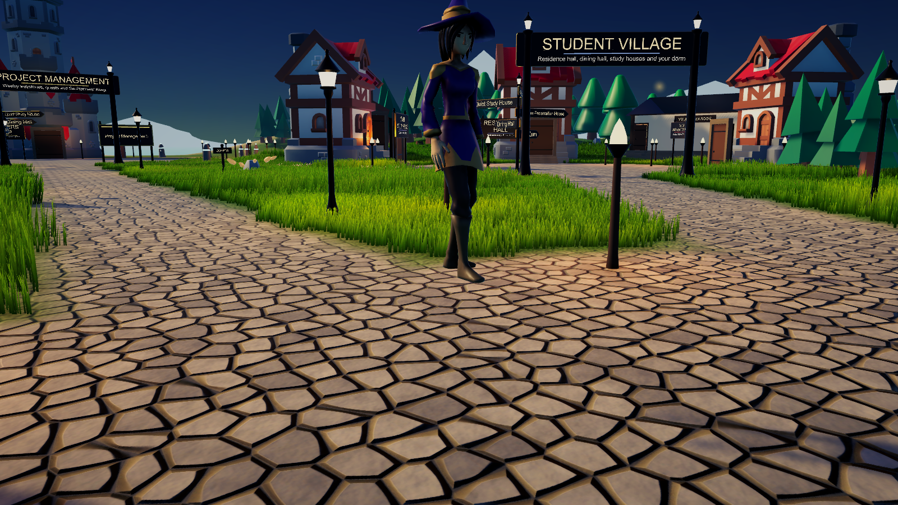
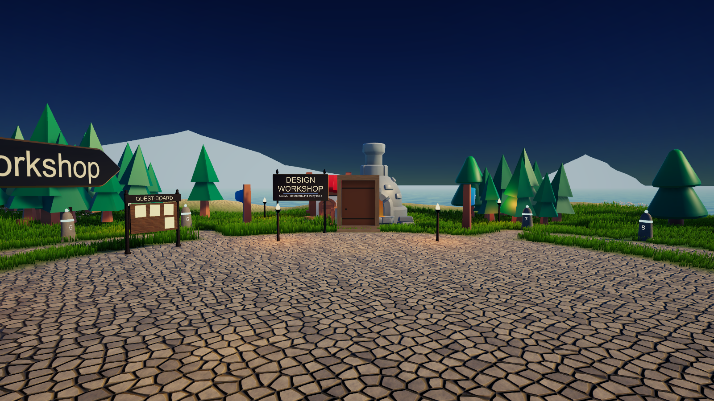

# Realm of Scholars

**A 3D study RPG that turns real university subjects into an adventure.** Each teaching week becomes a waystone on a quest trail, lectures become lessons in a gothic lecture theatre, and quiz questions become duels against rivals. Players earn XP, Focus and coins for genuine study.

Built as a web game (React + three.js) and now being rebuilt in **Unity 6**. Showcasing at the **La Trobe University Campus IT Expo, November 2026**.

_Screenshots from the Unity 6 version._

## How study maps to the game

| Real study | In the realm |
| --- | --- |
| Each teaching week | A waystone on the subject's trail: study it, then win its trial |
| Lectures | The Lecture Theatre, week by week, with check-in questions |
| Key terms | Flashcards in the library |
| Practice questions | Duels against a rival scholar |
| Questions you got wrong | Reviewed later at the study-group house |
| Focused study time | A meditation shrine with a real timer |

## Features

- Explorable campus with districts, recognisable buildings and walk-in interiors.
- First- and third-person movement (WASD, sprint, jump, mouse look).
- Highly customisable characters.
- Grades, WAM and study plan tracking, with course material import.
- Runs fully offline for the expo.

## Tech stack

| Version | Tools |
| --- | --- |
| Web | React 18, TypeScript, three.js, React Three Fiber, drei, Vite |
| Unity | Unity 6 (6000.6 LTS), Universal Render Pipeline, C#, glTFast, editor tooling that builds the campus scene from code |
| Art | CC0 model packs (KayKit, Quaternius), procedurally generated textures |

## Source code

This started as university work, so the source code is kept in a private repository. I'm happy to demo it or walk through it in an interview.

**Built by Omar Al Azhari** · [LinkedIn](https://www.linkedin.com/in/omar-alazhari-028a6a203)
