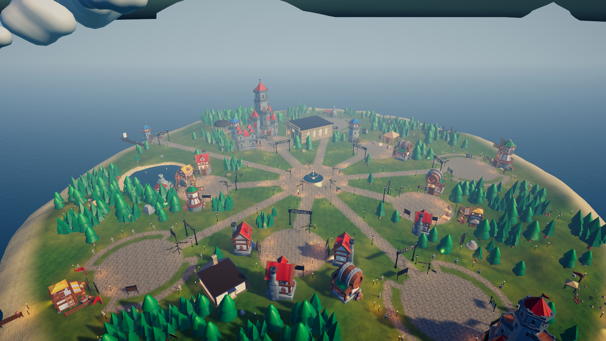
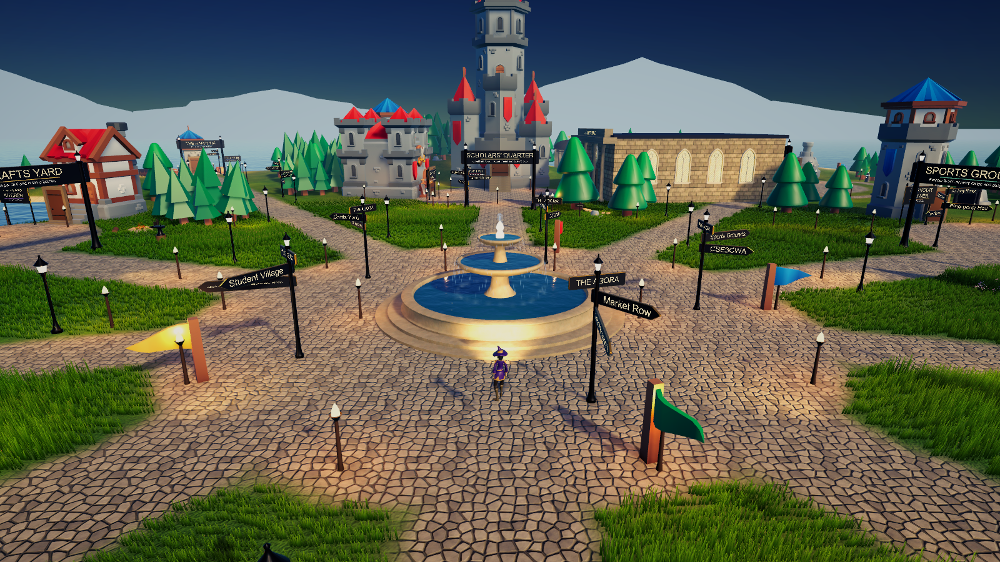

# Realm of Scholars

**A 3D study RPG that turns real university subjects into an adventure.** Each teaching week becomes a waystone on a quest trail, lectures play out in a gothic lecture theatre, and practice questions become duels against rival scholars. Players earn XP, Focus and coins for genuine study.

**Designed and built by Omar Al Azhari.** Showcasing at the **La Trobe University Campus IT Expo, 18 November 2026**. No public deployment yet; it runs locally in a minute (see [Run it locally](#run-it-locally)).

<p>


</p>
<p>


</p>

_Screenshots are from the Unity 6 rebuild (kept in a separate private repository for now). This repository is the web version, which is the expo build._

## Key features

| Real study | In the realm |
| --- | --- |
| Each teaching week | A waystone on the subject's trail: study it, then win its trial |
| Lectures | A lecture theatre with week-by-week lectures and check-in questions |
| Key terms | Flashcards in the library |
| Practice questions | Duels against a rival scholar |
| Questions you got wrong | Reviewed later at the study-group house |
| Focused study time | A meditation shrine with a real timer that only pays out after real time passes |

- **AI lectures (optional).** With an Anthropic API key, the server researches a subject (starting from its official La Trobe Handbook page, plus the student's own uploaded slides) and writes a structured lecture: spoken segments, slide bullets, examples, check-in questions and further reading.
- **AI rubric feedback that never writes the work.** Students paste a draft and get per-criterion feedback with evidence and one improvement each. The prompt and tests enforce that it never rewrites or supplies text.
- **Deadline import.** Reads Moodle calendar exports (.ics) and can connect to Moodle or Canvas, storing tokens encrypted on the server.
- **Explorable 3D campus** with first- and third-person movement, walk-in interiors and a customisable character creator.
- **Works offline** with ready-made lectures and hand-written question banks, so no live AI is needed (the expo build runs with none).

## Tech stack

| Area | Tools |
| --- | --- |
| Game and UI | React 18, TypeScript, three.js, React Three Fiber, drei, framer-motion, Vite |
| Server (serverless functions in `api/`) | Node, Anthropic SDK (Claude API), rate limiting, Moodle and Canvas clients |
| Documents | pdf.js and mammoth for reading uploaded outlines and slides |
| Quality | ESLint, strict TypeScript, and a 900+ check verification script |

## Run it locally

Needs Node.js 20 or newer.

```bash
npm ci
npm run dev          # http://localhost:5173
```

- `?expo` opens the guest mode used at the expo.
- `?classic` opens the original campus app.
- Optional: copy `.env.example` to `.env.local` and add an `ANTHROPIC_API_KEY` to turn on AI lectures and feedback. Without it, everything else works.
- Optional: `npx tsx scripts/import-latrobe-handbook.ts --pilot` downloads a sample of La Trobe Handbook subject data. The full Handbook data isn't included in this repository.

## How it's tested

```bash
npm run typecheck    # strict TypeScript
npm run lint         # ESLint, zero warnings allowed
npm run test:realm   # 915 checks across game rules, curriculum data, saves and the AI endpoints
npm run build        # production build
```

The AI endpoints are tested against a mocked SDK, so the test suite never calls the live API. The tests check, for example, that a missing key fails safely, that drafts are capped, and that the feedback prompt forbids rewriting the student's work.

## How it was built

I built Realm of Scholars myself: the game design, rules, world, content, AI features and test suite, in both the web version and the Unity 6 rebuild. I used an AI coding assistant (Claude Code) as a tool to write code faster, and I reviewed and tested every change. The lectures are original writing in the voice of fictional professors, and the question banks are hand-written practice questions; neither copies university materials.

## Challenges solved

- **Keeping AI output trustworthy.** Lectures cite only URLs the research step actually found, and the server cleans and caps every AI response before the game uses it.
- **Academic integrity by design.** The feedback feature comments against the rubric but is forbidden, and tested, never to write or paraphrase the student's work.
- **Running on a modest laptop.** The expo machine has integrated graphics and no internet, so the game falls back to ready-made lectures and question banks when there is no AI key or connection.
- **Two engines, one content set.** `scripts/export-unity-data.ts` exports the same curriculum data to the Unity 6 rebuild, so both versions stay in sync.

## Not included

To respect La Trobe University's copyright and assessment rules, this repository leaves out course materials, assessment briefs, transcribed LMS pages and the full Handbook scrape. Assessment records keep only titles, weights and dates.

[LinkedIn](https://www.linkedin.com/in/omar-alazhari-028a6a203) · [GitHub](https://github.com/Omar-Azhari)
