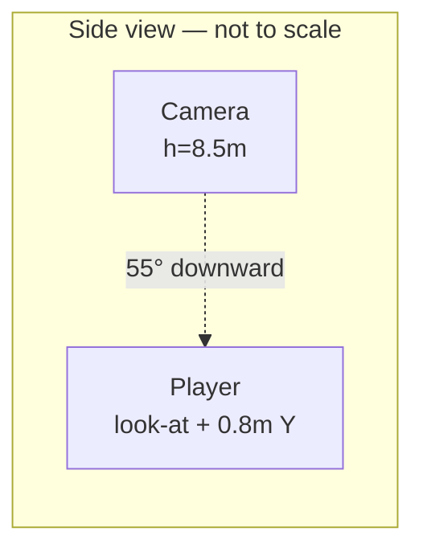

# UniGame Art Bible & Asset Standards

**Phase 20A.75 — Visual Identity Lock.** This document is the single
source of truth for how UniGame looks and feels, from this point forward.
Every future character, NPC, room, hallway, building, furniture piece,
icon, animation, and lighting preset must follow it. After this phase
there should be no ambiguity about how UniGame should look — only about
how quickly a given piece gets built.

**Scope discipline, matching the brief exactly:** this phase produces
*only* this document and the Milestone 20B–20F roadmap in Part 15. No
gameplay changed. No backend touched. No academic architecture touched.
No Character Creator, clothing, furniture models, or new rooms were built.
Every number below is either **(a) already locked in shipped code** —
cited with its exact file and constant name so it can never silently
drift — or **(b) a new standard**, clearly marked as such, for
territory nothing has been built in yet (a real asset pipeline, NPC
roles beyond the mentor, room themes beyond the one prototype room). The
two are never blended without saying which is which.

## Provenance key

Throughout this document:

- 🔒 **Locked (shipped)** — this value already exists in code today. The
  exact file/constant is cited. Changing it means editing that file, not
  just this document.
- 🆕 **New standard** — nothing exists yet; this is the target every
  future build must follow, established here for the first time.
- 🚧 **Flagged tension** — something already shipped that doesn't yet
  fully match this bible's target feel, disclosed honestly rather than
  quietly reconciled or hidden.

---

## Part 1 — Visual Identity

**UniGame is a stylised, warm, low-poly miniature-diorama university.**
The player should feel like they're looking down into a beautifully
crafted dollhouse-scale study space — not a photorealistic campus, not a
blocky sandbox, not a saccharine cartoon.

**Target (locked direction, established across 20A/20A.5, formalised here):**

| Trait | Meaning in practice |
|---|---|
| Stylised | Simplified, deliberately-proportioned forms — never an attempt at real-world accuracy |
| Warm | Honey woods, cream walls, terracotta fabrics — the World palette in Part 6 |
| Inviting | Nothing the player should feel wary of; every room reads as "someone's" |
| Low-poly | Flat/simple primitive-composed geometry, soft rounded edges over hard corners |
| Clean | Uncluttered silhouettes; decoration is deliberate, never noisy |
| Readable | Every object recognisable at bird's-eye distance without a label |
| Modern university | Contemporary study life — laptops, notebooks, whiteboards — not a medieval academy |
| Slight fantasy charm | A touch of storybook warmth (rounded proportions, cosy lighting) — not literal fantasy content |
| Miniature-diorama feeling | Camera and scale (Part 2/Part 4) conspire to make every room read as a crafted model, not a full-scale building |

**Explicitly avoid:**

- Photorealism (no PBR-accurate materials, no photoscanned textures)
- Horror (no harsh shadows, no desaturated/cold palettes as a default — see Part 7's "no harsh contrast" rule)
- Clutter (every prop in Part 8/9 earns its place — see Part 1's "clean")
- Noisy textures (flat colour + simple roughness beats busy surface detail)
- Hyper-saturated colours (every hex in Part 6 is a muted/warm-leaning tone, never a pure saturated primary)
- Excessive realism (rounded, simplified forms always win over anatomical/architectural accuracy)
- Exaggerated cartoon slapstick (no bouncy squash-and-stretch, no oversized comic gestures — Part 10's animation timing is calm, not zany)

---

## Part 2 — Camera Standards

**The camera is permanently locked.** No future room, hallway, or building
may invent its own camera behaviour — every scene consumes the same
`BirdsEyeCamera` component (🔒 `src/game3d/camera/BirdsEyeCamera.tsx`).

### Locked values

| Property | Value | Source |
|---|---|---|
| Downward angle | **~55°** (`atan(8.5 / 5.95)` ≈ 55.0°) | 🔒 `CAMERA_HEIGHT_M` / `CAMERA_DISTANCE_M` |
| Camera height above ground | 8.5m | 🔒 `CAMERA_HEIGHT_M` |
| Horizontal camera distance | 5.95m | 🔒 `CAMERA_DISTANCE_M` |
| Camera-to-target hypotenuse | ~10.4m | derived |
| Vertical field of view | 46° perspective (never orthographic) | 🔒 `Game3D.tsx`'s `<Canvas camera={{ fov: 46 }}>` |
| Follow damping | Exponential, `DAMP_SPEED = 5.5` (`1 - e^(-5.5·Δt)`) | 🔒 `BirdsEyeCamera.tsx` |
| Room-entry ease-in | Camera starts 1.35x further back (`ENTRY_PULLBACK`), then the same per-frame damping carries it to resting framing over roughly the first second | 🔒 `BirdsEyeCamera.tsx` |
| Look-at target | Character position, +0.8m on Y | 🔒 `BirdsEyeCamera.tsx` |
| Player screen-height (computed) | ~10–13% of viewport height at a 1.12m-tall character | derived from the above — see Part 3 |
| Player rotation control | **None.** Fixed yaw, always | 🔒 deliberate, documented in `BirdsEyeCamera.tsx`'s header |
| Player zoom control | **None.** Fixed distance, always | 🔒 deliberate, same rationale |

### Reasoning for "no rotation, no zoom" (locked as permanent, not a placeholder gap)

A player-driven orbit or zoom control is a **new input system**, not a
camera *value* — every phase of this project's Phase 20 work has drawn a
hard line between "retune an existing constant" and "add a new
interaction surface." The brief's own language ("very small rotation
allowance," "zoom only slightly") describes bounds on a *future* dynamic
camera, not a mandate to build one now. If a future milestone ever adds
either, the allowed envelope is:

- Rotation: **no more than ±8°** of yaw drift around the fixed default, and only ever camera-initiated (e.g. a subtle lead into a corner), never a player-dragged orbit.
- Zoom: **no more than ±15%** of `CAMERA_DISTANCE_M`, and it must still keep the full room in frame at both extremes.

Until a milestone explicitly proposes this, the camera stays perfectly
fixed-yaw, fixed-distance, matching this document's stronger, unambiguous
"fixed framing" requirement.

### Diagram — side view (to scale, approximately)

```
                                ● Camera
                               ╱│
                              ╱ │
                    10.4m    ╱  │ 8.5m
                  (hypotenuse) │  (CAMERA_HEIGHT_M)
                            ╱   │
                       55° ╱    │
                          ╱_____│
             ─────────────●─────────────  ground plane
                        Player (look-at + 0.8m)
                        ├──── 5.95m ────┤
                          (CAMERA_DISTANCE_M,
                           horizontal offset)
```



### Framing rules by context

| Context | Rule |
|---|---|
| **Room framing** | The whole room (wall-to-wall) should read as visible within frame, with a small margin — this drove the 20A.5 room shrink (Part 4) and the FOV widening from 42°→46° together, rather than either alone |
| **Movement framing** | The camera only ever follows position; it never re-frames or re-angles as the player walks — consistency over "cinematic" reaction |
| **Interaction framing** | No special camera move on interacting with an object (desk, door) — the interaction prompt and any opened panel sit in the existing 2D HUD layer (Part 12), never a camera cut |
| **Hallway framing** 🆕 | Not yet built (Milestone 20E). When built: same camera, same angle/distance/FOV — a hallway is simply a longer, narrower `SceneWorld`, not a different camera mode |
| **Door transition behaviour** 🆕 | Not yet built (single room today). Target: reuse the *exact* entry-ease mechanic already shipped for room mount (`ENTRY_PULLBACK`) when arriving in a new room, rather than inventing a second transition system — see Part 10 |
| **Room-to-room camera identity** | No room-specific camera parameters, ever. A room author changes furniture and materials (Part 4/8/9), never `BirdsEyeCamera.tsx` |

---

## Part 3 — Character Style Guide

All current values are 🔒 locked from `src/game3d/characters/PlaceholderCharacter.tsx`
(rewritten in Milestone 20A.5). Milestone 20B's real modular rig must
reproduce this exact silhouette — the point of locking it now is so the
placeholder's proportions **do not change** when real geometry replaces
the primitives.

### Proportions (🔒 locked)

| Part | Spec |
|---|---|
| Total height | ~1.12m |
| Head | Sphere, radius 0.30m (diameter 0.60m) |
| Head : torso-height ratio | 0.60 : 0.42 ≈ **1.43** — the head is deliberately, unambiguously larger than the torso is tall. This ratio is the single most important number in this section — it's what makes a character read as "UniGame" at a glance |
| Torso | 0.46m wide × 0.42m tall × 0.32m deep, rounded (`RoundedBox`, radius 0.09) |
| Arms | Capsule, radius 0.07m, length 0.18m, pivoted at the shoulder (y=0.45m) |
| Hands | Rounded cube, 0.14m, radius 0.05 |
| Feet | Rounded box, 0.18m × 0.10m × 0.28m, radius 0.04 |
| Eyes | Two spheres, radius 0.035m, offset ±0.09m (x) / 0.27m (z, forward) from head centre |
| Legs | None as a separate part — feet sit directly under the torso; a visible leg segment is reserved for Milestone 20B's rig, not required by this silhouette |

### Face style

Two small dark dot-eyes on the head's forward face (locked colour `#2c2320`,
see Part 5). No mouth, no eyebrows, no nose in this pass — "simple face,"
not an expression system. Milestone 20C ("Character Animation") may add a
minimal expression layer (e.g. a blink), but any addition must keep the
dot-eye motif rather than replacing it with detailed facial geometry.

### Material style

Every character material uses `roughness` 0.7–1.0 and **`metalness: 0`,
always** — matte skin, matte fabric, matte shoes, no exceptions. This is
the same "avoid shiny reflective materials" rule as every other part of
this document, applied to characters specifically because it's the
easiest place to accidentally reach for a glossy "plastic skin" shader.

### Polygon / texture budget (🆕 target for Milestone 20B's real rig)

| | Budget |
|---|---|
| Player / Mentor triangles | 3,000–6,000 (always on-screen, deserves the detail) |
| Background NPC triangles (student/staff/visitor) | 1,000–2,000 (LOD-reduced — see Part 14) |
| Texture size | 512×512 typical, 1024×1024 max |
| Animation clips per character | 5–8 max (idle, walk, talk, sit, wave, + 1–2 role-specific) — see Part 10/13 |

Today's placeholder is procedural primitive geometry (spheres/capsules/
`RoundedBox`) — its actual triangle count is a byproduct of segment counts
(head: 16×14, hands/feet: `smoothness=2`), not a deliberately-hit budget.
🚧 The budget above is the target for Milestone 20B's real mesh, not a
measurement of the current placeholder.

### Shadow style

`castShadow` on every body part, soft shadows via the room's shared
lighting rig (Part 7) — characters never cast their own special shadow
treatment.

### Animation style

See Part 10 for exact timings. In summary: calm, continuous idle motion
(never a frozen T-pose-adjacent stillness), no snap transitions between
poses — always an eased blend.

### Role identities

The player and the mentor/guide NPC already exist in code; lecturer,
student, staff, and visitor do not yet. All six share the **exact same
proportions above** — role is communicated through colour and (in later
milestones) minor silhouette accessories, never through a different body
shape. That consistency is deliberate: readability at bird's-eye distance
depends on every character having the same recognisable base silhouette.

| Role | Body colour | Status | Notes |
|---|---|---|---|
| **Player** | `#ff8a4c` (warm orange) | 🔒 shipped | `TestRoomScene.tsx` |
| **Mentor / Guide** | `#4f7cff` (calm blue) | 🔒 shipped | `TestRoomScene.tsx`; the only NPC with idle animation today (`NpcCharacter.tsx`) |
| **Lecturer** 🆕 | `#5c4a7a` (muted plum) — reads as "formal" without being cold | not yet built | Reserve a small accessory silhouette cue (e.g. a lanyard/blazer-collar shape) once modular clothing exists (20B) |
| **Student (background)** 🆕 | Varied, drawn from a small warm-leaning pool: `#e3a13a`, `#8fc1a9`, `#e88a9a`, `#7a5c8f` | not yet built | Rotate per-instance so a room full of students doesn't read as clones |
| **Staff** 🆕 | `#9a8b6f` (neutral olive-tan, "uniform" read) | not yet built | Deliberately less saturated than student colours — reads as "on duty," not personal |
| **Visitor** 🆕 | `#c9c2b3` (muted neutral) | not yet built | The least visually assertive role — visitors should recede, not draw the eye |

---

## Part 4 — Room Style Guide

Values below are 🔒 locked from the Milestone 20A.5 test room
(`src/game3d/rooms/testRoomWorld.ts`, `TestRoomScene.tsx`,
`TestRoomProps.tsx`) unless marked 🆕.

### Locked dimensions (from the shipped prototype room)

| Element | Spec |
|---|---|
| Room footprint (this room) | 6m × 4.8m |
| Wall height | 2.3m |
| Wall thickness | 0.15m |
| Door | 1.0m wide × 2.2m tall |
| Window | 1.3m wide × 1.0m tall |
| Desk | 1.6m × 0.75m footprint, 0.755m tall |
| Bookshelf | 1.3m × 0.32m footprint, 1.5m tall |
| Reading chair + nook envelope | 0.9m × 0.7m |
| Couch | 1.4m × 0.65m footprint (seat 0.2m tall + 0.4m back) |
| Walkable-area wall padding | 0.4m inset from every wall |
| Interaction distance (desk, door) | 0.7m radius |

### 🆕 New standards — room envelope for future rooms

To keep Part 2's camera math valid without per-room retuning, every
future room must stay within:

| | Min | Max | Reasoning |
|---|---|---|---|
| Room width | 5m | 8m | Below 5m the camera's fixed framing over-crops; above 8m the room stops reading as "mostly visible" at the locked FOV/distance |
| Room depth | 4m | 6.5m | Same reasoning, depth axis |
| Wall height | 2.2m | 2.6m | Keeps the "cosy," not "cavernous," ceiling feel from Part 1 |

### 🆕 New standards — not yet built

| | Target |
|---|---|
| Corridor width (Milestone 20E) | **1.8m minimum** clear walking width — comfortable two-avatar passing distance at this character scale |
| Camera safe zone | Keep primary interactive furniture within the central ~70% of the room footprint — the outer 15% margin on each side is where the fixed camera's framing gets tightest, so nothing critical should live there |
| Room padding (furniture-to-wall) | At least 0.3m clearance between any furniture obstacle and a wall, so the walkable band (Part 4's 0.4m inset) is never fully consumed by a piece pushed flush to a wall |

---

## Part 5 — Material Library

**A small, reusable set — never dozens of near-duplicate materials.**
Every material below is defined once, here, and referenced by name in
Part 8/9 rather than re-specified per object.

| Material | Base colour(s) | Roughness | Metalness | Colour usage | Shadow response | Normal maps |
|---|---|---|---|---|---|---|
| **Painted wall** | `#f2e6d2` (default), theme-varied per Part 9 | 1.0 | 0 | Large flat surfaces, warm off-white default | Soft, receives room shadows | None — flat colour only |
| **Timber (light)** | `#a97c50` | 0.9 | 0 | Desks, shelf frames, floors | Soft | None |
| **Timber (dark)** | `#8a5a34` / `#6b4a2f` | 0.85–0.9 | 0 | Doors, shelf dividers, trim | Soft | None |
| **Carpet / rug** | `#e3b774` fill, `#c98f4e` border | 1.0 | 0 | Floor accent zones only, never full-room flooring | Soft, minimal contact-shadow bleed | None |
| **Fabric (upholstery)** | `#c9694f`, `#b85c45` | 0.95 | 0 | Chairs, couches, cushions | Soft | None |
| **Glass (window)** 🆕 | `#fdf3d8`, emissive `#fbe6a8` @ 0.35 | 0.5 | 0 | Windows only — **not** true transparency/refraction; a warm emissive plane, deliberately cheap | N/A (emissive, doesn't receive shadow) | None |
| **Plastic (screens, small props)** 🆕 | Dark bezel `#3a3630`; screen surface cool emissive `#bcd9e8` (Part 7's one deliberate cool exception) | 0.4 (bezel), N/A (emissive screen) | 0 | Laptops, monitors | Soft | None |
| **Metal (simple, matte)** | `#9a9490` | 1.0 | **0, always** | Lamp arms, structural trim | Soft | None |
| **Whiteboard / paper** | `#fbf6ea` | 0.6 | 0 | Whiteboards, calendars, notebooks | Soft | None |
| **Plants** | Pot `#a9704f`, leaves `#5a8a52` | 0.9–0.95 | 0 | Any potted-plant prop | Soft, `flatShading` for a faceted low-poly leaf look | None |
| **Wood furniture (case goods)** | Reuses Timber (light/dark) above | — | — | Bookshelves, desks, chair frames | — | — |
| **Computer screens** | See Plastic above | — | — | — | — | — |

### Rules (permanent)

1. **`metalness` is always 0.** No material in UniGame is ever
   reflective — this is the single hardest constraint in this document
   and the one most likely to get accidentally violated by a future
   contributor reaching for a "shiny metal" shader. "Metal" is
   communicated by shape and a slightly cooler grey tone only.
2. **No normal maps.** The low-poly, soft-edge target (Part 1) is
   achieved through geometry (`RoundedBox`, generous smoothing) and flat
   colour, not surface-detail texturing. If a future milestone finds a
   genuine need for one (e.g. a fabric weave), it must be proposed as an
   amendment to this table, not added ad hoc.
3. **Glass and screens are the only emissive materials.** Reserving
   emissive materials for these two cases keeps them meaningful — a room
   full of emissive surfaces would undercut the "soft, warm" lighting
   goal in Part 7.
4. **New materials must extend this table, not create a parallel one.**
   Before adding a "new" material to any future room/furniture piece,
   check whether an existing entry already covers it with a different
   colour swap.

---

## Part 6 — Colour Palette

UniGame runs **two intentionally distinct colour registers** — this is
not a conflict to resolve, it's a deliberate split between the physical
3D world and the UI chrome that floats above it, and it existed in the
codebase (the 2D legacy HUD) well before the 3D work began. Both are
documented here so nobody accidentally invents a third.

### Register A — World / room materials (🔒 locked, established Milestone 20A.5)

The warm, physical palette used by every material in Part 5.

| Token | Hex | Usage |
|---|---|---|
| Floor (default) | `#d8bd8f` | Modern Campus theme floor |
| Wall (default) | `#f2e6d2` | Modern Campus theme wall |
| Wood light | `#a97c50` | Desks, shelf frames |
| Wood dark | `#8a5a34` / `#6b4a2f` | Doors, trim, dividers |
| Fabric | `#c9694f` / `#b85c45` | Upholstery |
| Rug fill / border | `#e3b774` / `#c98f4e` | Rugs |
| Paper | `#fbf6ea` | Whiteboards, notebooks |
| Plant pot / leaf | `#a9704f` / `#5a8a52` | Plants |
| Metal | `#9a9490` | Matte metal trim |
| Sun light | `#ffdca6` | Directional "afternoon" light |
| Lamp glow | `#ffcf8a` | Desk/reading lamp point lights |
| Hemisphere sky / ground | `#fff6e6` / `#c9a876` | Soft indirect fill |
| Ambient | `#fff2df` | Base room fill |

### Register B — UI / HUD chrome (🔒 locked, established Phase 2 — `src/styles/tokens.css`, unchanged by this bible)

Cool, dark, game-menu chrome — deliberately different from the warm world
it floats above, the same way a console's system UI can differ from the
game it's showing.

| Token | Hex | Usage |
|---|---|---|
| `--hq-bg` | `#0b1220` | HUD/menu backdrop |
| `--hq-panel` / `--hq-panel-alt` | `#141b2e` / `#1b2338` | Panel surfaces |
| `--hq-border` | `#2a3550` | Panel borders |
| `--hq-text` / `--hq-text-muted` | `#e7ecf7` / `#9aa6c0` | Text |
| `--hq-accent` | `#22d3ee` (cyan) | Primary HUD accent, XP bar |

### Subject accent pairs (🔒 locked, 4 assigned + 🆕 2 reserved)

| Subject slot | Accent | Accent 2 | Panel |
|---|---|---|---|
| User Interface Design | `#b24bf3` | `#f345c0` | `#1b1330` |
| Cloud-Based Web App Dev | `#3da9fc` | `#c7d0da` | `#0e1a2b` |
| Project Management | `#ffb238` | `#1e2a52` | `#141b2e` |
| Professional Practices | `#2ed17e` | `#f4c542` | `#0e1f17` |
| 🆕 Reserved slot 5 | `#f36b6b` (rose) | `#5c4a7a` | `#221419` |
| 🆕 Reserved slot 6 | `#3ac9c0` (teal) | `#2a3550` | `#0e2020` |

Every future subject follows this pattern: one accent, one accent-2, one
matching dark panel tone — never a bare single colour.

### Status colours (🔒 locked, currently expressed inline — formalised here as canonical)

| Status | Hex | Source |
|---|---|---|
| Success | `#2ed17e` | `.notification-item--success` |
| Warning | `#ffb238` | `.notification-item--warning`, `[data-urgency="soon"]` |
| Error / overdue | `#ff6b6b` | `[data-urgency="overdue"]` |

### XP

XP uses the HQ accent gradient (`--gradient-hq: linear-gradient(135deg, #22d3ee, #6d8dfc)`)
— no separate "XP colour" exists or should be invented; XP is visually
part of the HQ/neutral register, not a subject.

---

## Part 7 — Lighting

**No room may invent its own lighting rig.** Every room consumes the same
three-light baseline plus optional lamp point-lights; only the *values*
change per time-of-day/theme preset below.

### Baseline rig (🔒 locked, `TestRoomScene.tsx`)

| Light | Colour | Intensity | Notes |
|---|---|---|---|
| Ambient | `#fff2df` | 0.4 | Base fill, never zero (Part 1's "no harsh contrast") |
| Hemisphere (sky/ground) | `#fff6e6` / `#c9a876` | 0.5 | Cheap soft indirect bounce, no postprocessing |
| Directional "sun" | `#ffdca6` | 1.15 | `shadow-radius: 4`, `shadow-mapSize: 1024` — soft shadows, always |
| Lamp point lights | `#ffcf8a` | 0.55–0.7 | Distance 1.8–2.2m, decay 2 — the standard "lamp" recipe for any future lamp prop |

### 🆕 Time-of-day / context presets (targets — not yet implemented)

| Preset | Ambient | Sun | Notes |
|---|---|---|---|
| **Afternoon** | *(this is the shipped baseline above — no change needed)* | | |
| **Morning** | `#fff4e2` @ 0.45 | `#fff0d4` @ 1.0, higher elevation angle | Brighter, slightly cooler-white than afternoon, still warm |
| **Evening** | `#f5e6d0` @ 0.35 | `#ffb066` @ 0.8, lower angle (longer shadows) | Deeper amber, cosier |
| **Night** | `#40485c` @ 0.15 | off (intensity ≈ 0) | Lamps become the dominant light source — this is the one context allowed to go cool, since it's meant to read as "lights are what's on" |
| **Library** | `#eef1f0` @ 0.35, no direct sun | — | Studious hush — dimmer, relies on lamps, per Part 9's Cozy Library theme |
| **Computer glow** | *(unchanged ambient)* | — | A small cool `#bcd9e8` emissive accent on screens only (Part 5) — the **one** deliberate, deliberately-limited cool exception in an otherwise warm game |

### Rules

1. Shadows are always soft (`shadow-radius` ≥ 4, never 0/hard-edged).
2. Ambient never drops to true black, even at "Night" — Part 1 forbids a
   horror-game read.
3. Real SSAO postprocessing is explicitly **not** part of this game's
   lighting model — a hand-placed dark, low-opacity disc under furniture
   (🔒 `ContactShadow` in `TestRoomProps.tsx`) is the permanent, cheap
   stand-in. This avoids a new rendering dependency (`@react-three/postprocessing`)
   for a stylised game that was never targeting physically-based AO.
4. A literal "light shining through the window" simulation is
   deliberately not attempted — the window is a visual glazing element
   (Part 5); the directional sun light provides the room's actual
   illumination.

---

## Part 8 — Furniture System

Every category below defines scale, polygon budget, style, materials
(referencing Part 5's library by name), interaction rules, and variants.
🔒 = at least one variant of this category is shipped in the 20A.5
prototype room; 🆕 = category target, not yet built.

| Category | Scale envelope | Poly budget | Materials | Interaction | Variants |
|---|---|---|---|---|---|
| **Desk** 🔒 | 1.4–1.8m W × 0.7–0.8m D, 0.72–0.76m tall | 150–300 | Wood (light) | **Locked pattern: desks open the Study Planner** (or a future room's equivalent "do your work here" panel) | Solo desk (shipped); corner desk, standing desk (future) |
| **Bookshelf** 🔒 | 1.1–1.4m W × 0.3–0.4m D, 1.4–1.6m tall | 200–400 | Wood (light+dark), varied book colours | Decorative by default; reserved to open a Resources/reading-list panel (Part 12) | Short 2-shelf (shipped); tall 3–4 shelf, corner unit (future) |
| **Chair** 🔒 | 0.45–0.55m seat W/D, 0.4–0.45m seat height, 0.65–0.75m back | 100–200 | Fabric + Wood (dark) legs | Decorative; no gameplay hook yet | Reading chair (shipped); desk chair, bench (future) |
| **Couch** 🔒 | 1.2–1.6m W × 0.6–0.7m D, 0.7–0.9m tall (with back) | 250–400 | Fabric | Decorative/rest spot; no gameplay hook yet | Loveseat (shipped); armchair, corner sectional (future) |
| **Plant** 🔒 | Pot 0.18–0.22m dia × 0.15–0.2m tall; foliage 0.3–0.5m total | 60–120 | Plants | None — purely decorative | Desk plant, floor plant (shipped); hanging plant (future) |
| **Lamp** 🔒 | Desk: 0.25–0.35m tall; floor: 0.9–1.2m tall | 80–150 | Metal + warm emissive shade | None directly — ambient light source (Part 7) | Desk lamp, floor reading lamp (shipped); wall sconce (future) |
| **Whiteboard / Noticeboard** 🔒 | 0.9–1.1m W × 0.6–0.8m tall, ~0.03m thick | 20–60 | Whiteboard/paper material | Reserved for a future "notes" panel | Whiteboard, corkboard, calendar cluster (all shipped) |
| **Computer** 🆕 | Monitor 0.35–0.45m W, 0.3m desk-depth footprint | 150–250 | Plastic (bezel + emissive screen) | Reserved: a future "research/search" panel | Desktop monitor (new target); laptop (shipped — reclassified as this category's compact variant) |
| **Decoration** (awards, folders, sticky notes, mugs, pens) 🔒 | Small props, no fixed envelope | 10–60 each | Any Part 5 material | None — purely decorative | Unlimited stylistic variety, provided every variant uses only Part 5's material list |

---

## Part 9 — Room Themes

Six themes, finalised. **Every theme reuses the exact same furniture
catalogue (Part 8) and material library (Part 5)** — a theme is a
palette/lighting/furniture-selection choice, never new geometry. This is
what makes six themes cheap: no theme requires its own art pass.

| Theme | Wall | Floor | Trim | Lighting preset (Part 7) | Default furniture | Ambience |
|---|---|---|---|---|---|---|
| **1. Modern Campus** 🔒 (shipped default) | `#f2e6d2` | `#d8bd8f` | Wood dark `#8a5a34` | Afternoon | Desk, bookshelf, reading nook, couch, plants | Productive, tidy, sunlit |
| **2. Cozy Library** 🆕 | Deep tan `#c9a876` | Walnut `#6b4a2f` | Brass/dark wood | Library | Tall bookshelf, reading chair, rug — more books, less desk-tech | Hushed, warm, book-lined |
| **3. Minimal Study** 🆕 | Pale warm white `#f7f2e8` | Light ash `#e8dcc8` | Thin light wood | Morning | Single desk + minimal chair, no couch, one plant | Calm, uncluttered, focus-first |
| **4. Creative Studio** 🆕 | Dusty terracotta accent panel `#d98a68` | Warm grey-wood | Muted teal accent | Afternoon + extra lamp warmth | Drafting-style desk, corkboard-heavy walls, more decorations | Expressive, a little messier, personal |
| **5. Digital Lab** 🆕 | Soft warm grey `#d9d3c8` | Matte dark grey-blue composite | Brushed matte metal `#9a9490` | Computer glow (dominant) + dimmer ambient | Two computer desks, minimal decor | Focused, quietly technical — the one theme allowed to lean cooler, still never cold/harsh (Part 1's bounded exception) |
| **6. Classic Academy** 🆕 | Deep wood panel `#6b4a2f` | Parquet (alternating light/dark wood) | Ornate-but-simple wood | Evening | Large bookshelf, wood desk, traditional chair, awards/trophies | Traditional, distinguished, warm wood everywhere |

---

## Part 10 — Animation Style

"Everything should feel calm. No frantic animations." — every timing
below is chosen (or flagged) against that standard.

| Timing | Value | Status |
|---|---|---|
| Walk speed | 640 scene-units/s = 6.4 m/s | 🔒 shipped (`useWorldMovement.ts` `SPEED`) — 🚧 **flagged tension:** this reads faster than a real "calm" walk pace; it's shared with the legacy 2D renderer, so it can't be retuned in isolation without affecting that game too. Reconciling this is explicitly deferred to Milestone 20C (see Part 15) |
| Run speed | Not implemented — single speed only | 🆕 reserve for a future sprint modifier; no number invented here |
| Movement easing (visual layer) | Position damping `POS_SMOOTH_SPEED = 9`, yaw damping `YAW_SMOOTH_SPEED = 7`, shortest-path turning | 🔒 `TestRoomScene.tsx` |
| NPC idle — look-around period | 6.5s | 🔒 `NpcCharacter.tsx` |
| NPC idle — breathing bob period | 2.4s | 🔒 `NpcCharacter.tsx` |
| NPC idle — stretch cadence | Every 14s, lasting 1.4s, eased in/out | 🔒 `NpcCharacter.tsx` |
| Interaction response | Instant (no wind-up before an E-press/click registers) | 🔒 shipped |
| Camera follow settle | ~0.5–0.8s to mostly converge (`DAMP_SPEED = 5.5`) | 🔒 |
| Camera room-entry ease | ~1s (`ENTRY_PULLBACK = 1.35` decaying via the same damping) | 🔒 |
| Door transition 🆕 | Target 0.3–0.4s swing/fade | Not yet built (single room today) |
| Room/scene transition 🆕 | Target 0.2–0.3s crossfade, reusing the camera's existing entry-ease rather than a new system | Not yet built |
| Celebration timing 🆕 | Target ~1–1.5s brief pulse-and-settle, never a fanfare-length sequence | Not yet built for the 3D world (2D legacy has its own, unaudited here) |

---

## Part 11 — Sound Style

UniGame already has a real, shipped sound-event architecture — 🔒
`src/lib/sound.ts` — even though **no audio files exist yet**. This part
documents the *style* future audio must follow, using the exact event
names already wired in code as the concrete production list.

### Architecture (🔒 shipped, reference only — not modified here)

- Opt-in Settings toggle, **off by default**.
- Gameplay code calls `emitSound("event-name")`; if `public/assets/audio/<event>.mp3`
  doesn't exist, it fails silently — audio can be dropped in later, file
  by file, with zero code changes.
- Existing event list (the production checklist for future audio work):
  `footsteps`, `hover`, `door-open`, `door-close`, `room-enter`,
  `module-complete`, `xp-gain`, `achievement-unlock`, `warning`,
  `celebration`, `focus-start`, `focus-pause`, `focus-resume`,
  `focus-complete`, `focus-cancel`, `timer-warning`, `chair-move`,
  `monitor-on`, `room-upgrade`, `relationship-up`.

### 🆕 Style direction (new — no audio exists to check this against yet)

| Category | Direction |
|---|---|
| Music | Sparse, ambient, lo-fi-study-adjacent warmth. Never dominant — always easily backgroundable |
| Room ambience | Soft page-rustle / quiet murmur, very low volume, optional per theme |
| Footsteps | Soft, material-appropriate (carpet vs. wood per Part 9's theme), never a sharp click |
| UI sounds | Short, soft, low-pitched confirmation tones — never an arcade beep |
| Interaction sounds | Gentle, object-appropriate: desk = paper shuffle, door = soft wood creak + latch, bookshelf = page flip |
| Achievement / celebration | A short warm chime — not a fanfare blast |

**Avoid loud arcade effects** — reiterated as the one hard rule across
every category above.

---

## Part 12 — UI Style Guide

**Doctrine: the world is the primary interface. Menus support the world,
they never compete with it.** This was already true before this document
— confirmed during Milestone 20A.5's audit that `WorldShell.tsx` wraps
the 3D scene with exactly this minimal HUD. This part formalises it as
permanent doctrine and gives it a name.

### The locked minimal HUD (🔒 shipped, `WorldShell.tsx`)

- Top-left: level + XP.
- Top-centre: location name + one tracked objective.
- Top-right: compact minimap.
- A collapsible tab rail: Tasks / Subjects / Calendar / Menu.
- Everything else — Settings, Profile, Study Planner, Semester Setup —
  opens as an overlay panel **on demand**, never sits permanently on
  screen.

### Moving interactions into the world (🆕 target pattern; 2 of 6 anchors already wired)

| Anchor | Status | Opens |
|---|---|---|
| Desk | 🔒 wired | Study Planner |
| Mentor | 🔒 wired | Dialogue |
| Bookshelf | 🆕 target | Resources / reading list |
| Computer | 🆕 target | Research/search panel |
| Noticeboard | 🆕 target | Announcements / reminders |
| Wardrobe | 🆕 target | **Character Creator (20B)** — a natural, world-native entry point worth deliberately reserving now |

### Panel visual spec (🔒 locked, from existing CSS)

| Property | Value |
|---|---|
| Background | `rgba(9, 14, 26, 0.82–0.94)` — dark navy translucent |
| Corner radius | 7–12px for cards, 999px for pills |
| Border | 1–2px, using the relevant accent colour (Part 6) |
| Blur | `backdrop-filter: blur(3px)` for light overlays; `blur(14px)` for full modal backdrops |
| Elevation | `--elevation-1/2/3` soft neutral drop shadows (Part 6's Register B) |

### Typography and icons (🔒 locked)

- Display font "Press Start 2P" for short HUD labels/headings **only** —
  never body text.
- Body font: system sans-serif stack.
- Icons: `lucide-react` line icons exclusively, consistent stroke weight —
  no mixing in filled or duotone icon sets.

---

## Part 13 — Asset Pipeline

**🆕 Entirely new territory** — the current 3D room is 100% procedural
Three.js primitive geometry; no GLB model has been imported yet. This
part defines the pipeline for when real models arrive (Milestone 20B+).

| Concern | Standard |
|---|---|
| Folder structure | `public/assets/models/<category>/<name>.glb` — mirrors the existing `public/assets/` manifest convention the 2D engine already uses. Categories: `characters/`, `furniture/`, `rooms/`, `props/` |
| GLB naming | kebab-case, category-prefixed: `char-player-base.glb`, `furn-desk-modern.glb`, `room-shell-cozy-library.glb` |
| Texture naming | Matches its GLB, suffixed by map type: `furn-desk-modern_basecolor.png`, `_roughness.png` (no `_normal` — Part 5 rule #2) |
| Animation naming | Verb-based clip names embedded in the GLB (`idle`, `walk`, `talk`, `sit`, `wave`) — identical across every rigged character so Milestone 20C's animation system can address any character by the same clip name |
| LOD strategy | Single LOD for now (current budgets already keep triangle counts low — Part 14). A simple 2-tier LOD (full / simplified) is reserved for background NPCs only once real crowds exist (20F+) |
| Compression | GLB with Draco/meshopt once real models exist; textures to KTX2/Basis where supported, falling back to PNG/JPEG |
| Reuse / instancing | Identical repeated pieces (e.g. the same bookshelf across many rooms) **must** use drei's `<Instances>` rather than duplicate draw calls, once real furniture models exist |
| Atlas rules | Small decorative props (books, folders, mugs, stationery) share one small texture atlas per category, not one texture per prop |
| Asset IDs | Every placed instance gets a stable string id, matching the existing `WorldInteractable.id` convention already used by the interaction system — never depend on array position |

---

## Part 14 — Performance

**Target hardware: integrated graphics laptops** (explicit, permanent
constraint) — every budget below is sized conservatively for that class
of device, not a gaming desktop.

| Budget | Value |
|---|---|
| Player / Mentor triangles | 3,000–6,000 |
| Background NPC triangles | 1,000–2,000 (LOD-reduced) |
| Furniture triangles | 50–400 per piece (Part 8's per-category table) |
| Room shell triangles (excl. furniture) | < 500 |
| Total scene budget (one fully-dressed room) | < 15,000 triangles |
| Texture size | 512×512 typical, 1024×1024 max |
| Animation clips per character | 5–8 max |
| Draw calls per room | < 150 (instancing/merging required to hit this once real models exist — the current procedural room is already well under) |
| Memory (GLB + textures, one fully-dressed room) | < 5MB uncompressed target |
| Bundle size | Unchanged discipline: all Three.js/R3F code stays behind the `React.lazy` boundary already proven across 20A and 20A.5 (main bundle measured unaffected both times); new GLB/texture assets load on-demand per room, never bundled into the JS chunk |
| Shadow map resolution | 1024 (current setting; do not increase without a measured need) |

---

## Part 15 — Implementation Plan (roadmap only — nothing built this phase)

Every milestone below is a plan, not code. Each one's job is to follow
this Art Bible, not to reinterpret it.

### Milestone 20B — Character Creator
Build the modular character rig replacing `PlaceholderCharacter`,
reproducing Part 3's locked proportions exactly (the 1.43 head:torso
ratio above all else) so the shipped silhouette carries forward
unchanged. Character Creator UI follows Part 12's panel spec. Save-data
schema for a stored character configuration is additive, matching this
project's established additive-only save-compatibility pattern (see
`docs/PHASE_20_3D_WORLD_CUSTOMISATION.md`). Reserve the "Wardrobe" world
anchor (Part 12) as its entry point.

### Milestone 20C — Animation
Replace today's procedural stand-ins — `NpcCharacter.tsx`'s sine-wave
idle and `TestRoomScene.tsx`'s visual movement-smoothing layer — with a
real skeletal/blend animation system, using Part 10's locked timings and
Part 13's clip-naming convention. This is the natural point to resolve
Part 10's flagged walk-speed tension (🚧), likely via proper
animation-driven motion rather than the raw scene-unit hook.

### Milestone 20D — Room Editor / first real customisable room
Replace the hand-built `testRoomWorld.ts` prototype fixture with
manifest-driven room data, built from Part 4's dimensional standards,
Part 8's furniture catalogue, and Part 9's six themes. This is also where
the bookshelf/computer/noticeboard interaction anchors flagged in Part 12
get wired up for real.

### Milestone 20E — Hallway
Build the corridor system using Part 4's locked 1.8m minimum corridor
width and Part 10's door-transition timing target, connecting multiple
20D-built rooms with the same camera (Part 2) — no hallway-specific
camera mode.

### Milestone 20F — Full campus
Assemble all rooms and hallways into the full four-subject campus
(matching the existing legacy 2D layout's four subjects), applying Part
14's performance budgets at full scale — this is where instancing and LOD
(Part 13) stop being "reserved for later" and start actually mattering.

**None of 20B–20F begin in this phase.** This document is the prerequisite
reference for all of them.

---

## Stop condition — checklist

- [x] `docs/UNIGAME_ART_BIBLE.md` is complete.
- [x] Every future asset category has a documented standard (Parts 3, 8, 13).
- [x] Camera is permanently defined (Part 2).
- [x] Character proportions are permanently defined (Part 3).
- [x] Materials are standardised (Part 5).
- [x] Colour palette is fixed (Part 6).
- [x] Lighting rules are fixed (Part 7).
- [x] Furniture rules are fixed (Part 8).
- [x] Room standards are fixed (Part 4, 9).
- [x] Performance budgets are fixed (Part 14).
- [x] Asset pipeline is documented (Part 13).
- [x] Implementation roadmap for 20B–20F produced (Part 15), nothing built.

No Character Creator, clothing, furniture models, or gameplay changes
were made in this phase.
